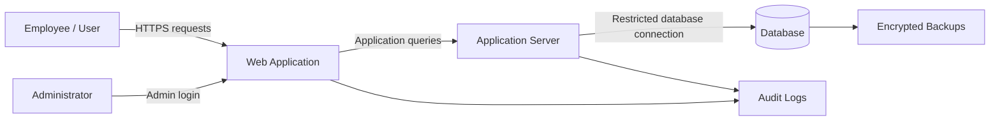

# Threat Model

## 1. Purpose
Identify plausible threats in a hypothetical small-organization web system and recommend risk-reduction measures.

## 2. System boundary
**In scope:** employee endpoints, web application, application server, database, administrator access, internal network and internet-facing entry point.
**Out of scope:** third-party services and real systems not explicitly authorized for testing.

## 3. Assets
- User and administrator credentials
- Application and configuration files
- Database records
- Service availability
- Audit logs and backups

## 4. High-level data flow

## 5. STRIDE threat table
| STRIDE category | Example threat | Potential impact | Example mitigation |
|---|---|---|---|
| Spoofing | Attacker uses compromised account | Unauthorized access | MFA, strong authentication, rate limiting |
| Tampering | Unauthorized changes to records | Data integrity loss | Server-side validation, least privilege, integrity monitoring |
| Repudiation | Actions are not adequately logged | Weak accountability | Centralized, time-synchronized, protected logs |
| Information disclosure | Excessive database permissions or weak transport security | Data exposure | TLS, least privilege, secrets management |
| Denial of service | High request volume exhausts resources | Service disruption | Rate limits, monitoring, capacity controls |
| Elevation of privilege | Misconfigured role grants admin capabilities | Full system compromise | Role review, secure defaults, periodic access audits |

## 6. Assumptions and limitations
This is a hypothetical, desk-based exercise. No live scanning or exploitation was performed. Example threats are not confirmed vulnerabilities in a real system.
